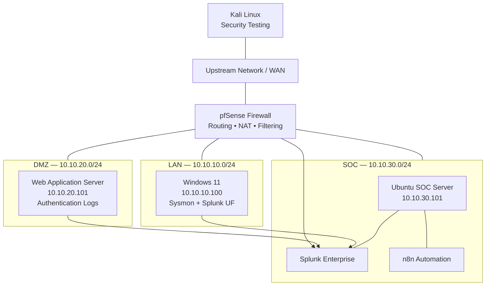
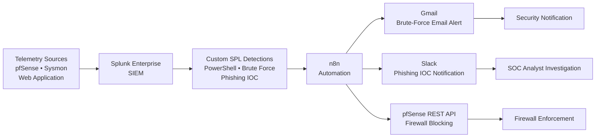
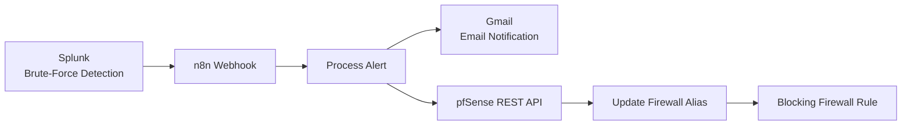
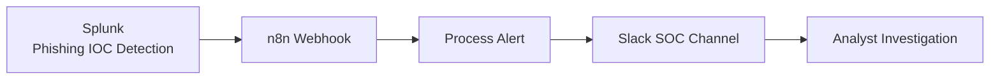

# Splunk Enterprise-Based SOC Lab
### SIEM | Detection Engineering | SOAR Automation

A multi-zone Security Operations Center (SOC) lab built around **Splunk Enterprise**, integrating centralized security monitoring, custom detection engineering, network security controls and automated response workflows.

The project demonstrates how security telemetry from different environments can be collected, analyzed, correlated and transformed into actionable security alerts, notifications and response actions.

---

## Table of Contents

- [Project Overview](#project-overview)
- [Project Objectives](#project-objectives)
- [Architecture](#architecture)
  - [Logical Network Architecture](#1-logical-network-architecture)
  - [SOC Telemetry and Response Workflow](#2-soc-telemetry-and-response-workflow)
- [SIEM Implementation](#siem-implementation--splunk-enterprise)
- [Custom Detection Engineering](#custom-detection-engineering)
  - [DET-001 — Suspicious PowerShell Activity](#det-001--suspicious-powershell-activity)
  - [DET-002 — Brute-Force Detection](#det-002--brute-force-detection)
  - [DET-003 — Phishing IOC Correlation](#det-003--phishing-ioc-dns--tls-correlation)
- [SOAR Automation](#soar-automation--n8n)
  - [Brute-Force Response](#workflow-1--brute-force-response-gmail--pfsense)
  - [Phishing IOC Notification](#workflow-2--phishing-ioc-slack-notification)
- [Security Testing and Validation](#security-testing-and-validation)
- [Technology Stack](#technology-stack)
- [Key Learning Outcomes](#key-learning-outcomes)
- [Project Scope and Limitations](#project-scope-and-limitations)
- [Repository Contents](#repository-contents)
- [Author](#author)
- [Disclaimer](#disclaimer)

---

## Project Overview

The objective of this project was to design and implement a practical SOC environment that demonstrates the security monitoring lifecycle:

**Telemetry Collection → SIEM Analysis → Threat Detection → Alerting → Automated Response → Analyst Investigation**

Instead of focusing exclusively on log collection and dashboards, this project connects SIEM detections with automation workflows to demonstrate how security events can lead to operational actions.

The lab combines network segmentation, endpoint monitoring, application security telemetry, custom SPL detection rules, email and Slack notifications, and API-driven firewall response.

## Project Objectives

- Deploy a centralized SIEM platform using Splunk Enterprise.
- Design a segmented virtual network using pfSense.
- Collect security telemetry from multiple sources.
- Develop custom SPL-based detection rules.
- Correlate DNS and TLS events with threat intelligence indicators.
- Integrate Splunk alerts with n8n.
- Automate selected security response actions through REST APIs.
- Send automated Gmail notifications for brute-force detections.
- Send structured Slack notifications for phishing IOC detections.
- Validate detection and response workflows through controlled security simulations.

---

## Architecture

### 1. Logical Network Architecture

The lab uses four network zones to separate endpoints, application services, security monitoring and external connectivity.

| Zone | Network | Components |
|---|---|---|
| WAN | `192.168.1.0/24` | Upstream network, Kali Linux, pfSense WAN |
| LAN | `10.10.10.0/24` | Windows 11 endpoint |
| DMZ | `10.10.20.0/24` | Web application server |
| SOC | `10.10.30.0/24` | Ubuntu server, Splunk Enterprise, n8n |

**Network gateways and main systems**

| Component | IP address |
|---|---|
| pfSense WAN | DHCP address on upstream network |
| pfSense LAN | `10.10.10.1` |
| Windows 11 | `10.10.10.100` |
| pfSense DMZ | `10.10.20.1` |
| DMZ Web Server | `10.10.20.101` |
| pfSense SOC | `10.10.30.1` |
| Ubuntu SOC Server | `10.10.30.101` |

Kali Linux is connected to the upstream private network and is used for controlled security testing.

#### Network Topology

### 2. SOC Telemetry and Response Workflow

The monitoring architecture brings together three main telemetry sources:

| Source | Collection method | Purpose |
|---|---|---|
| pfSense | Syslog — UDP 5514 | Firewall and network events |
| Windows 11 | Sysmon + Splunk Universal Forwarder | Endpoint process activity |
| DMZ Web Application | Application authentication logs | Login activity and failed authentication attempts |

Splunk Enterprise acts as the central analysis and detection platform.

---

## SIEM Implementation — Splunk Enterprise

Splunk Enterprise is the central SIEM platform used to collect, search, analyze and correlate security events.

### Data Sources

**1. pfSense Firewall Logs**

- Centralized firewall and network event collection.
- Syslog forwarding to Splunk.
- Network activity monitoring and investigation.

**2. Windows Endpoint Telemetry**

- Sysmon installation and configuration.
- Splunk Universal Forwarder deployment.
- Process creation monitoring through Sysmon Event ID 1.
- Collection of endpoint security events.

**3. Web Application Authentication Logs**

- Collection of application authentication events.
- Monitoring of successful and failed login attempts.
- Analysis of repeated authentication failures.

---

## Custom Detection Engineering

Three custom SPL-based detections were developed to demonstrate different security monitoring scenarios.

### DET-001 — Suspicious PowerShell Activity

**Objective:** Identify potentially suspicious PowerShell process execution through command-line pattern matching.

**Telemetry:** Windows Sysmon — Event ID 1 (Process Creation).

**Detection logic:**

The rule monitors PowerShell process creation and searches for suspicious command-line patterns such as:

- Encoded PowerShell arguments (`-enc`).
- `DownloadString`.
- `IEX`.
- `Invoke-WebRequest`.

**Security value:**

Provides visibility into potentially suspicious PowerShell activity and helps analysts identify commands that deserve further investigation.

**MITRE ATT&CK references:**

- T1059.001 — PowerShell.
- T1105 — Ingress Tool Transfer.

These techniques are relevant references for the monitored behaviors, not proof that every matching event is malicious.

### DET-002 — Brute-Force Detection

**Objective:** Identify rapid consecutive failed authentication attempts against the DMZ web application.

**Telemetry:** Web application authentication logs.

**Detection logic:**

The SPL detection analyzes failed login events and groups activity by username and source IP address.

It uses time-based analysis to identify rapid authentication attempts and generates an alert containing:

- Username.
- Source IP address.
- Number of rapid failed attempts.
- First observed event.
- Last observed event.
- Host information.

**Automated response: Gmail + pfSense**

When the detection triggers:

1. Splunk forwards the alert to an n8n webhook.
2. n8n processes the detection information.
3. An automated **Gmail email notification** is sent with the brute-force detection details.
4. n8n communicates with the pfSense REST API.
5. The external test source IP is added to a firewall alias.
6. The corresponding pfSense firewall rule blocks traffic from that source.

**Gmail notification information:**

- Detection name and severity.
- Target username.
- Source IP address.
- Number of rapid failed attempts.
- First and last observed timestamps.
- Relevant host information.

**Security value:**

Helps identify potential password-guessing activity and demonstrates an automated response combining security notifications and firewall enforcement.

**MITRE ATT&CK reference:**

- T1110 — Brute Force.

### DET-003 — Phishing IOC: DNS + TLS Correlation

**Objective:** Identify suspicious domain activity by correlating DNS and TLS telemetry with a custom phishing IOC lookup.

**Telemetry:**

- pfSense DNS events.
- pfSense TLS events.
- Custom phishing IOC CSV lookup.

**Detection logic:**

The detection:

1. Extracts the observed domain from DNS and TLS events.
2. Normalizes the domain.
3. Searches the custom IOC lookup.
4. Identifies matching suspicious domains.
5. Correlates DNS and TLS event types.
6. Generates an alert containing the source IP, domain, destination information and supporting evidence.

**Custom lookup structure:**

`phishing_domains.csv`

| Field | Description |
|---|---|
| domain | Domain indicator |
| description | Indicator description |
| severity | IOC severity |
| source | Indicator source |

**Automated response: Slack SOC notification**

When the detection triggers:

1. Splunk forwards the alert to an n8n webhook.
2. n8n processes the alert and supporting event information.
3. An automated **Slack notification** is sent to the dedicated SOC channel.
4. The notification provides the analyst with the context required for further investigation.

**Slack notification information:**

- Detection name.
- Suspicious domain.
- Source IP address.
- Destination IP addresses and ports.
- IOC severity and confidence.
- Indicator source and description.
- Supporting DNS and TLS telemetry.
- Event count.
- First and last observed timestamps.
- Investigation status.

**Security value:**

Improves visibility into suspicious domain activity by combining network telemetry with known indicators and providing structured information to the SOC analyst.

**Important security decision:**

The phishing workflow does not automatically isolate the endpoint. Visiting a suspicious URL alone does not prove compromise. Additional evidence and analyst authorization are required before host isolation.

**MITRE ATT&CK reference:**

- T1071.004 — DNS.

---

## SOAR Automation — n8n

n8n is used to orchestrate response workflows triggered by Splunk security alerts.

The integration connects SIEM detection results with notification platforms and firewall management APIs.

### Workflow 1 — Brute-Force Response: Gmail + pfSense

**Workflow sequence:**

**Response actions:**

- Send an automated Gmail notification containing the detection information.
- Update the pfSense firewall alias through its REST API.
- Block the external test source IP using the corresponding firewall rule.

**Response objective:**

Demonstrate an automated response to a controlled brute-force simulation, combining email-based security notification with firewall enforcement.

**Technologies:** Splunk Enterprise, n8n, Gmail SMTP, pfSense REST API.

### Workflow 2 — Phishing IOC: Slack Notification

**Workflow sequence:**

**Notification information:**

- Detection name.
- Suspicious domain.
- Source IP address.
- Destination IP addresses and ports.
- IOC severity and confidence.
- Indicator source and description.
- Supporting DNS and TLS telemetry.
- Event count.
- First and last observed timestamps.
- Investigation status.

**Response objective:**

Provide structured, actionable security notifications to the SOC analyst for further investigation.

**Technologies:** Splunk Enterprise, n8n, Slack.

**Important security decision:**

The phishing workflow prioritizes analyst investigation rather than automatic endpoint isolation. Additional evidence and analyst authorization are required before taking containment actions.

---

## Security Testing and Validation

Controlled security simulations were performed inside the lab to validate the detection and response mechanisms.

| Test | Source | Expected result |
|---|---|---|
| Suspicious PowerShell activity | Windows 11 | DET-001 detection in Splunk |
| Brute-force simulation | Kali Linux | DET-002 detection, Gmail notification and pfSense firewall response |
| Phishing IOC simulation | Controlled test domain | DET-003 detection and Slack notification |

### Validation Objectives

- Verify that telemetry reaches Splunk.
- Confirm that custom SPL searches identify the expected activity.
- Validate alert triggering and notification delivery.
- Verify Gmail notification delivery for brute-force alerts.
- Verify Slack notification delivery for phishing IOC alerts.
- Validate n8n webhook processing.
- Confirm the pfSense firewall response for the controlled brute-force test.
- Ensure phishing notifications contain sufficient investigation context.

All simulations are performed in an authorized, controlled educational environment.

---

## Technology Stack

| Category | Technologies |
|---|---|
| SIEM | Splunk Enterprise |
| Firewall and Network Security | pfSense |
| SOAR / Automation | n8n |
| Endpoint Monitoring | Sysmon |
| Log Forwarding | Splunk Universal Forwarder |
| Security Testing | Kali Linux |
| Operating Systems | Ubuntu, Windows 11 |
| Application / Infrastructure | PostgreSQL, Docker |
| Detection Language | SPL |
| API Integration | REST API |
| Email Notifications | Gmail |
| SOC Notifications | Slack |
| Security Framework | MITRE ATT&CK |

---

## Key Learning Outcomes

This project provided practical experience in:

- Deploying and configuring a SIEM platform.
- Centralizing security telemetry from multiple sources.
- Developing custom SPL detection rules.
- Monitoring Windows endpoint activity.
- Analyzing firewall and application authentication logs.
- Correlating DNS and TLS events with threat intelligence indicators.
- Designing network segmentation and firewall policies.
- Integrating SIEM alerts with automation workflows.
- Implementing API-driven firewall response.
- Configuring automated Gmail and Slack security notifications.
- Building analyst-oriented investigation workflows.
- Validating detection and response mechanisms through controlled simulations.

---

## Project Scope and Limitations

This project is a controlled educational SOC lab, not a production SOC deployment.

Some important considerations:

- PowerShell detection is based on command-line patterns and can generate false positives.
- Brute-force detection depends on the available authentication telemetry and configured time threshold.
- Phishing IOC detection depends on the quality and coverage of the custom IOC lookup.
- DNS and TLS correlation does not prove that a user submitted credentials or that a system was compromised.
- Automated firewall blocking is demonstrated against a controlled test source.
- Phishing-related endpoint isolation is intentionally not automated.

These limitations are important when evaluating detection accuracy and designing responsible security response procedures.

---

## Repository Contents

This repository currently serves as the main project documentation and architecture overview.

It documents:

- Logical network architecture.
- SOC telemetry and response workflow.
- Splunk SIEM implementation.
- Custom SPL detection use cases.
- n8n automation workflows.
- Gmail and Slack notification integrations.
- pfSense API-based firewall response.
- Security testing and validation methodology.

The actual lab environment and its configurations are maintained separately. This repository should not be considered a complete deployable lab package.

---

## Author

**Wassim Jmili**

Cybersecurity Engineering Student | SOC Operations | SIEM | Blue Team Security

- GitHub: [wassim078](https://github.com/wassim078)
- LinkedIn: [Wassim Jmili](https://www.linkedin.com/in/wassim-jmili-517423248/)
- Portfolio: [wassim078.github.io](https://wassim078.github.io/)

---

## Disclaimer

This project was developed for educational and defensive cybersecurity purposes.

All security testing and simulations were conducted within an authorized lab environment. The techniques and workflows documented here are intended for learning, security monitoring and defensive validation.

---

**Splunk Enterprise-Based SOC Lab — SIEM, Detection Engineering & SOAR Automation**
